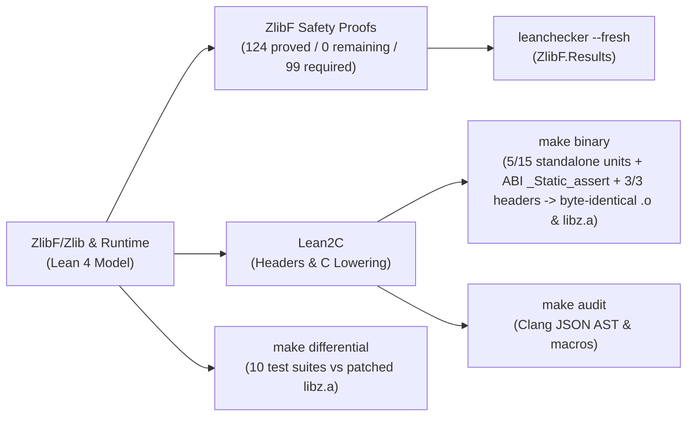

# zlib-lean

**Safety-only formal verification of patched zlib (`1.4.0.1-motley`) in Lean 4, with byte-identical C binary integration.**

This repository narrows the verification scope exclusively to **memory and execution safety** for the 86 documented public APIs of zlib `1.4.0.1-motley` (`617e19a` + 6 patches in [pins.json](pins.json)) targeting the default x86-64 Linux LP64 static build. Non-safety (functional correctness / round-trip) proof modules have been pruned from the codebase and registry.

## Architecture



## Verification Status

| Layer | Scope & Result | Entrypoint / Artifact |
| --- | --- | --- |
| **Safety Proofs** | **124 / 124** safety goals proved (**0** unproved, **99** required); kernel-checked with only `propext`, `Classical.choice`, `Quot.sound`. | [ZlibF/Results.lean](ZlibF/Results.lean) · `make proof` |
| **Binary Equivalence** | **`_Static_assert` ABI layout check** passes on all **10** ABI structs (**163** fields: `struct z_stream_s`, `struct gz_header_s`, `ct_data`, `static_tree_desc`, `tree_desc`, `deflate_state`, `code`, `struct inflate_state`, `struct gzFile_s`, `gz_state`); **3 / 3** generated headers byte-equal; **5 / 15** standalone 100%-Lean `.c` units (`adler32.c`, `compress.c`, `gzclose.c`, `uncompr.c`, `zutil.c`; **21** functions) + **15** spliced functions (**36** Lean functions in `.o` total; **1** skipped variadic `gzprintf`, **123** unlowered) compile to **15 / 15** byte-identical `.o` units and a **byte-identical `build/libz.a`**. | [tools/binary_audit.py](tools/binary_audit.py) · `make binary` |
| **Clang AST Audit** | All **86** public APIs located; **15** target macro constants verified; **3 / 3** headers byte-equal; **13** lowered function bodies AST-identical (`11` differ only in C syntax while compiling to identical `.o` bytes). | [tools/audit.py](tools/audit.py) · `make audit` |
| **Differential Testing** | Compiled Lean model (`ZlibF/Zlib`) matches patched C `libz.a` line-for-line across **10** fixed-seed test suites on pinned Linux targets (covering the `123` unlowered functions and skipped variadic `gzprintf`). | [tools/differential.py](tools/differential.py) · `make differential` |

### Standalone Lowering Progress (5 / 15 Units)

Route 1 eliminates reliance on original C source files unit-by-unit via `bin/lean2c abi-sources` using the Zlib-agnostic compiler ([Lean2C/Simple.lean](Lean2C/Simple.lean), [Lean2C/ABI.lean](Lean2C/ABI.lean), [Lean2C/Archive.lean](Lean2C/Archive.lean)):

- **Standalone 100%-Lean (5)**: `adler32.c`, `compress.c`, `gzclose.c`, `uncompr.c`, `zutil.c` (0 lines of original `.c`, compiled directly to byte-identical `.o`).
- **Remaining / spliced (10)**: `inftrees.c`, `gzlib.c`, `crc32.c`, `infback.c`, `gzwrite.c`, `gzread.c`, `inffast.c`, `trees.c`, `inflate.c`, `deflate.c`.

For caller preconditions, platform/allocator assumptions, the Trusted Computing Base (TCB), and accepted C undefined-behavior exceptions (`Ptr.add p 0`, `Ptr.diff .null .null`), see [docs/SAFETY.md](docs/SAFETY.md).

## Commands

Requires Git, Python 3.9+, Make, Clang, and the Lean toolchain specified in [lean-toolchain](lean-toolchain).

```sh
git clone --recurse-submodules https://github.com/cla7aye15I4nd/zlib-lean
cd zlib-lean
make binary && make audit && make test
```

| Command | Purpose |
| --- | --- |
| `make binary` | Verify `_Static_assert` ABI struct layouts across all 10 ABI structs (163 fields), compile standalone 100%-Lean units (`5/15`) and spliced units (`10/15`) with Lean-generated headers (`3/3`), and check byte-identical `.o` files and `build/libz.a` (report: `build/binary-report.json`). |
| `make binary-pinned` | Run `make binary` enforcing the pinned Clang version and `x86_64-unknown-linux-gnu` target from [pins.json](pins.json). |
| `make audit` | Emit C and compare normalized Clang JSON ASTs and target macros across all 15 translation units (report: `build/ast-report.json`). |
| `make audit-pinned` | Run `make audit` under the pinned Linux Clang configuration in [pins.json](pins.json). |
| `make ast-equal` | Strict gate requiring full AST equality for every translation unit and body (expected to fail on unlowered functions). |
| `make differential` | Build patched zlib and Lean drivers, then run all 10 fixed-seed differential test suites ([tests/list.txt](tests/list.txt)). |
| `make test` | Run Lean shift-lowering tests and Python AST/binary/byte-comparison unit tests ([tests/test_fidelity.py](tests/test_fidelity.py)). |
| `make proof` | Build `ZlibF` with `--wfail` and replay `ZlibF.Results` in a fresh kernel via `leanchecker --fresh` (~10 GB RAM). |
| `make emit` | Emit Lean C backend output and the 3 generated headers (`crc32.h`, `inffixed.h`, `trees.h`) into `build/generated/`. |
| `make reference` | Reconstruct the 26-file patched C baseline in `build/reference/` from [upstream/](upstream) and [patches/](patches). |
| `make bytes` | Byte-for-byte comparison between `build/reference/` and `build/generated/` (`build/bytes.json`). |

## Provenance & License

Derived from [oss-proof](https://github.com/cla7aye15I4nd/oss-proof/blob/0784b3e17eb85bb7699f55cb975ed1d47c1452dc/projects/zlib/README.md) at commit `0784b3e`, with non-safety proof modules removed to retain only the safety verification closure. Upstream zlib source pin and SHA-256 patch digests live in [pins.json](pins.json); modified zlib sources retain [patches/ZLIB-LICENSE](patches/ZLIB-LICENSE).
