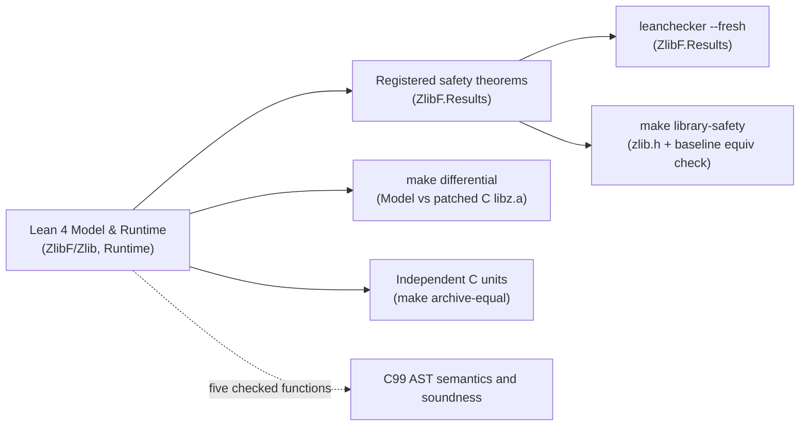

# zlib-lean

**Memory and execution safety of the Lean 4 model of patched zlib (`1.4.0.1-motley`).**

The model targets the default x86-64 Linux LP64 static build. Its contracts cover 86 documented public functions and specify legal memory accesses, allocation ownership, permitted stream histories, and when a call must return. `make archive-equal` compares the library generated from Lean with the library built from the pinned C sources. Applying a model theorem to the original C also requires a correspondence proof for the operations it uses. [Source and patches](pins.json) · [Safety scope and open correspondence issues](docs/SAFETY.md)

## Using the Safety Theorems

`whole_library_safety` selects the baseline contract for each documented function and the four stream protocols for deflate, inflate, inflateBack, and gzip. `extended_library_safety` also requires the contracts for C-ABI companions and for sequential calls interleaved across disjoint streams. `make proof` checks that each selection has a registered proof. [Proof registry](ZlibF/Results.lean) · [Contract selectors](ZlibF/Spec/Safety/WholeLibrary.lean)

```lean
import ZlibF.Results

open ZlibF.Results ZlibF.Spec.Public

example : Goal.compressBound_z := whole_library_safety.1 .compressBound_z
example : Goal.inflateCopy_safety := whole_library_safety.1 .inflateCopy
example : Goal.gz_sequence_safety := whole_library_safety.2 .gzip

example : Goal.compress2_c_safety := extended_library_safety.2.1 .compress2_c
example : Goal.multi_stream_step_safety := extended_library_safety.2.2 .stepSafety
```

See [ZlibF/Spec/Safety/WholeLibrary.lean](ZlibF/Spec/Safety/WholeLibrary.lean) for the selector definitions, [tests/public-api.json](tests/public-api.json) for the per-API mapping from C functions to Lean goals, and [docs/SAFETY.md](docs/SAFETY.md) for a C-auditor walkthrough of the safety predicates.

## What Is Verified (and What Is Not)



- **Safety proof replay.** `make proof` checks the [registry](ZlibF/Results.lean) and replays it in a fresh kernel. It fails if a required contract lacks a registered theorem or depends on an axiom beyond `propext`, `Classical.choice`, and `Quot.sound`. `make library-safety` also checks coverage against patched `zlib.h` and preservation of the baseline contracts at `85cd20c` and the C-ABI and multi-stream contracts at `50c4359`. Both this check and the independent Linux archive comparison run on every push and pull request. [Baseline check](tools/check_baseline_equiv.py) · [Lean equivalence tests](tests/LemmaEquivalence.lean)
- **Formal C99 AST semantics & soundness for lowered kernels**: [Lean2C/Semantics.lean](Lean2C/Semantics.lean) and [Lean2C/Soundness.lean](Lean2C/Soundness.lean) (tested in [CSourceSoundness.lean](tests/CSourceSoundness.lean)) prove C99 §6.5.7 shift UB-freedom, load/store and loop simulation, and end-to-end `runCFn` soundness for the live lowered C ASTs of `compressBound_z`, `compressBound`, `zlibCompileFlags`, `byte_swap`, and `adler32_combine_`.
- **Executable model differential checks**: Fixed-seed test suites compare executables compiled from the Lean model against patched C `libz.a` across the default Linux LP64 configuration (`make differential`).
- **Independent Linux translation.** For the x86-64 Linux build in [pins.json](pins.json), Clang compiled the 15 C units generated independently from Lean. Every object and the full `libz.a` matched the patched C build byte for byte. The [archive check](tools/archive.py) builds both sides and compares each object and the complete static library. See the [translation assumptions](docs/SAFETY.md#2-trusted-computing-base-tcb) for the scope of the source-level proofs.

For assumptions, C undefined-behavior boundaries, and the C-auditor walkthrough, see [docs/SAFETY.md](docs/SAFETY.md). For runtime, proof, and compiler module layout, see [docs/ARCHITECTURE.md](docs/ARCHITECTURE.md).

## Commands

Requires Git, Python 3.9+, Make, Clang, and the Lean toolchain specified in [lean-toolchain](lean-toolchain).

```sh
git clone --recurse-submodules https://github.com/cla7aye15I4nd/zlib-lean
cd zlib-lean
make library-safety && make test
```

| Command | Purpose |
| --- | --- |
| `make library-safety` | Build `ZlibF` with `--wfail`, replay `ZlibF.Results` via `leanchecker --fresh`, verify all 86 public APIs against patched `zlib.h` ([check_public_safety.py](tools/check_public_safety.py)), and verify baseline equivalence against `85cd20c` ([check_baseline_equiv.py](tools/check_baseline_equiv.py)). |
| `make proof` | Build `ZlibF` with `--wfail` and replay `ZlibF.Results` in a fresh Lean kernel (~10 GB RAM). |
| `make test` | Build `Lean2C.Lower`, `Lean2C.Soundness`, and the `ZlibF.Results` registry imported by the tests with `--wfail`, run Lean tests with `-DwarningAsError=true` ([ShiftLowering.lean](tests/ShiftLowering.lean), [SafetyRules.lean](tests/SafetyRules.lean), [LemmaEquivalence.lean](tests/LemmaEquivalence.lean), [CSourceSoundness.lean](tests/CSourceSoundness.lean)), and run Python unit tests ([test_public_safety.py](tests/test_public_safety.py), [test_baseline_equiv.py](tests/test_baseline_equiv.py), [test_fidelity.py](tests/test_fidelity.py)). |
| `make differential` | Build patched C `libz.a` and Lean drivers, then compare outputs across 10 fixed-seed test suites ([tests/list.txt](tests/list.txt); full Linux parity targets x86-64 LP64). |
| `make binary` | Diagnostic C compilation check: verify `_Static_assert` ABI layouts across 10 structs, compile generated standalone units and spliced C units, and emit `build/binary-report.json`. |
| `make source-bounds` | Check the two length-bound definitions in patched and generated `compress.c` against [machine-checked LP64 proofs](Lean2C/OriginalBounds.lean). Change one shift in each source and require Lean to reject each altered definition. |
| `make source-byteswap` | Check the complete `byte_swap` body in both versions of `crc32.c`, including Clang’s integer conversions. For every 32-bit word, both return the model’s byte swap and preserve the heap. [Proof](Lean2C/OriginalByteSwap.lean) |
| `make source-zerror` | Check both `zError` bodies and their ten string literals. Every signed input selects an in-bounds entry and returns the expected read-only message. [Proof](Lean2C/OriginalError.lean) |
| `make source-length-guards` | Check the argument guards in both C versions of `compress2_z` and `uncompress2_z`, including short-circuiting before a length dereference. |
| `make source-compress-lengths` | Check both source wrappers from argument validation to return with modeled deflate calls. Replay the [wrapper correspondence](Lean2C/OriginalCompress.lean) and its alignment and pointer-subtraction conditions. |
| `make source-uncompress-lengths` | Check both `uncompress2_z` wrappers through return, including the [zero-capacity member address](Lean2C/OriginalUncompressReturn.lean) and [aliased length cells](Lean2C/OriginalUncompressLengths.lean) in the shared ABI frame. |
| `make source-restore` | Check both decoder sources against Lean for register writebacks, 37 input-byte steps, four `lens[have++]` stores, four `order[have++]` reads, both length-repeat loops, and both forward match-copy loops. Check the two extra-bit loop guards, 19 callback sites, the complete stored-block case and the operands of all three `inflate_table` calls, the fast path, and the final callback and stream writeback in `inflateBack`. Replay the addressed and bounded callback theorems in a fresh kernel. Reject targeted mutations. |
| `make source-tally` | Check the 24 symbol-byte writes and both pairs of checksum reads in the dictionary header and zlib trailer, in patched and generated C. Lean must reject a changed destination and a wrong checksum field. [Compression checks](docs/SAFETY.md) |
| `make archive-equal` | Use the pinned Linux toolchain to compare independently generated objects and the full `libz.a` with patched C. The command exits unsuccessfully if an object is missing or any bytes differ. |
| `make reference` | Reconstruct the 26-file patched C baseline in `build/reference/` from [upstream/](upstream) and [patches/](patches). |

## Provenance & License

Derived from [oss-proof](https://github.com/cla7aye15I4nd/oss-proof/blob/0784b3e17eb85bb7699f55cb975ed1d47c1452dc/projects/zlib/README.md) at commit `0784b3e` and focused on the safety verification closure. Upstream zlib source pins and patch SHA-256 digests are recorded in [pins.json](pins.json); modified zlib sources retain [patches/ZLIB-LICENSE](patches/ZLIB-LICENSE).
