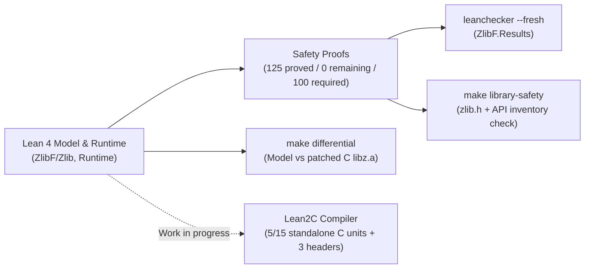

# zlib-lean

**Formal memory- and execution-safety verification of patched zlib (`1.4.0.1-motley`) in Lean 4.**

`zlib-lean` verifies memory safety, bounds safety, allocation ownership, and termination properties for all **86** documented public functions of patched zlib (`617e19a` + 6 patches in [pins.json](pins.json)) targeting the default x86-64 Linux LP64 static build, alongside an experimental Lean-to-C compiler (`Lean2C`).

## Using the Safety Theorems

The single entry-point theorem [`ZlibF.Results.whole_library_safety`](ZlibF/Results.lean) provides the full safety contract for every documented `zlib.h` function (`PublicEntry`) and for the four stateful single-object protocols (`deflate`, `inflate`, `inflateBack`, and `gzip` via `StreamProtocol`):

```lean
import ZlibF.Results

open ZlibF.Results ZlibF.Spec.Public

example : Goal.compressBound_z := whole_library_safety.1 .compressBound_z
example : Goal.inflateCopy_safety := whole_library_safety.1 .inflateCopy
example : Goal.gz_sequence_safety := whole_library_safety.2 .gzip
```

See [ZlibF/Spec/Safety/WholeLibrary.lean](ZlibF/Spec/Safety/WholeLibrary.lean) for the full selector definitions and [tests/public-api.json](tests/public-api.json) for the per-API mapping from C functions to Lean goals.

## What Is Verified (and What Is Not)



- **Formally proved in Lean 4**: All **125** safety goals in [ZlibF/Results.lean](ZlibF/Results.lean) are proved (**0** unproved, **100** required, including `whole_library_safety`), replayed in a fresh kernel with `leanchecker --fresh`, checked to depend only on `propext`, `Classical.choice`, and `Quot.sound`, and matched against the documented declarations in reconstructed `zlib.h` (`make library-safety`).
- **Executable model differential checks**: Fixed-seed test suites compare executables compiled from the Lean model against patched C `libz.a` across the default Linux LP64 configuration (`make differential`).
- **Lean-to-C compilation (work in progress — no equivalence claimed)**: [Lean2C](Lean2C/Simple.lean) compiles **5 / 15** standalone C units (`adler32.c`, `compress.c`, `gzclose.c`, `uncompr.c`, `zutil.c`), generates **3** header files (`crc32.h`, `inffixed.h`, `trees.h`), and checks C ABI struct layouts via `_Static_assert` for **10** core structs (**163** fields). The remaining **10 / 15** units (`crc32.c`, `deflate.c`, `gzlib.c`, `gzread.c`, `gzwrite.c`, `infback.c`, `inffast.c`, `inflate.c`, `inftrees.c`, `trees.c`) are not yet independently compiled from Lean, and this repository does **not** claim binary equivalence or full C AST equivalence with upstream `libz.a`.

For assumptions, C undefined-behavior boundaries, and theorem lookup rules, see [docs/SAFETY.md](docs/SAFETY.md). For runtime, proof, and compiler module layout, see [docs/ARCHITECTURE.md](docs/ARCHITECTURE.md).

## Commands

Requires Git, Python 3.9+, Make, Clang, and the Lean toolchain specified in [lean-toolchain](lean-toolchain).

```sh
git clone --recurse-submodules https://github.com/cla7aye15I4nd/zlib-lean
cd zlib-lean
make library-safety && make test
```

| Command | Purpose |
| --- | --- |
| `make library-safety` | Build `ZlibF` with `--wfail`, replay `ZlibF.Results` via `leanchecker --fresh`, and verify all 86 public APIs against patched `zlib.h` ([check_public_safety.py](tools/check_public_safety.py)). |
| `make proof` | Build `ZlibF` with `--wfail` and replay `ZlibF.Results` in a fresh Lean kernel (~10 GB RAM). |
| `make test` | Build regression modules and run Lean ([ShiftLowering.lean](tests/ShiftLowering.lean), [SafetyRules.lean](tests/SafetyRules.lean)) and Python unit tests ([test_public_safety.py](tests/test_public_safety.py), [test_fidelity.py](tests/test_fidelity.py)). |
| `make differential` | Build patched C `libz.a` and Lean drivers, then compare outputs across 10 fixed-seed test suites ([tests/list.txt](tests/list.txt); full Linux parity targets x86-64 LP64). |
| `make binary` | Diagnostic C compilation check: verify `_Static_assert` ABI layouts across 10 structs, compile generated standalone units and spliced C units, and emit `build/binary-report.json`. |
| `make reference` | Reconstruct the 26-file patched C baseline in `build/reference/` from [upstream/](upstream) and [patches/](patches). |

## Provenance & License

Derived from [oss-proof](https://github.com/cla7aye15I4nd/oss-proof/blob/0784b3e17eb85bb7699f55cb975ed1d47c1452dc/projects/zlib/README.md) at commit `0784b3e` and focused on the safety verification closure. Upstream zlib source pins and patch SHA-256 digests are recorded in [pins.json](pins.json); modified zlib sources retain [patches/ZLIB-LICENSE](patches/ZLIB-LICENSE).
