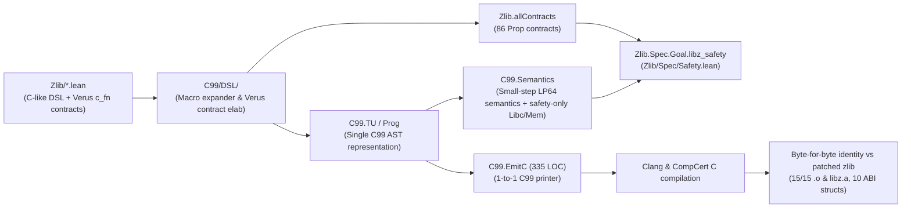

# zlib-lean

**Modernized, C-like Lean 4 source and Verus-style safety specification of patched zlib (`1.4.0.1-motley`), byte-for-byte identical to compiled C across all 15 translation units.**

The repository targets the default x86-64 LP64 static library build defined in [pins.json](pins.json) (`zlib` commit `617e19a8` + 6 patches). Rather than maintaining separate Lean models and C differential test suites, every zlib C unit is written directly in a thin C-like Lean 4 macro DSL ([C99/DSL/](C99/DSL)), elaborated to a single C99 AST ([C99/AST.lean](C99/AST.lean)) shared between small-step C99 operational semantics ([C99/Semantics.lean](C99/Semantics.lean)) and a 335-LOC 1-to-1 C printer ([C99/EmitC.lean](C99/EmitC.lean)).

Every one of the **86 documented public APIs** in `zlib.h` carries an embedded Verus-style `requires` / `modifies` / `ensures` safety contract directly on its `c_fn` definition in `Zlib/*.lean`, aggregated into [Zlib.allContracts](Zlib.lean#L46-L63) and [Goal.libz_safety](Zlib/Spec/Safety.lean#L101-L111). Formal proof migration for `Goal.libz_safety` (reusing and adapting lemmas from the pre-modernization proof suite preserved on `origin/main`) is the next phase on branch `dev`.

## Architecture at a Glance



| Layer | Purpose | Key Files |
| --- | --- | --- |
| **Core C99 TCB (2,179 LOC)** | Zlib-agnostic LP64 C99 AST, byte-block memory, safety-only POSIX/libc, small-step semantics, 1-to-1 C printer | [AST.lean](C99/AST.lean) · [Mem.lean](C99/Mem.lean) · [Libc.lean](C99/Libc.lean) · [Semantics.lean](C99/Semantics.lean) · [EmitC.lean](C99/EmitC.lean) |
| **C-like DSL + Verus Interface** | C99 parser/macros/elaborator erasing Verus `requires`/`modifies`/`ensures` clauses from C output | [Contract.lean](C99/DSL/Contract.lean) · [Syntax.lean](C99/DSL/Syntax.lean) · [Macro.lean](C99/DSL/Macro.lean) · [Elab.lean](C99/DSL/Elab.lean) |
| **Patched zlib in Lean** | All 4 shared ABI headers, 3 static tables, and all 15 C translation units with 86 Verus contracts | [Headers/Common.lean](Zlib/Headers/Common.lean) · [Tables/](Zlib/Tables) · [Zlib.lean](Zlib.lean) |
| **Safety-Only Spec (316 LOC)** | Client handle view, buffer/ownership predicates, and top-level `Goal.libz_safety` target | [Memory.lean](Zlib/Spec/Memory.lean) · [Safety.lean](Zlib/Spec/Safety.lean) |
| **Binary Equality & Audits** | 15/15 object/archive byte comparison, ABI `_Static_assert` verification, API coverage, kernel axiom & TCB hygiene | [Main.lean](Main.lean) · [verify.sh](scripts/verify.sh) |

For detailed module responsibilities and design rationale, see [docs/ARCHITECTURE.md](docs/ARCHITECTURE.md). For safety scope, Trusted Computing Base limits, and C17 UB exceptions, see [docs/SAFETY.md](docs/SAFETY.md).

## Commands

Requires Git, Make, Clang (`clang-18` + `llvm-18` on Linux for pinned archive comparison), and the Lean toolchain in [lean-toolchain](lean-toolchain). Zero Python dependencies.

```sh
git clone --recurse-submodules https://github.com/cla7aye15I4nd/zlib-lean
cd zlib-lean
make build && make binary-equal && make check-api && make check-tcb
```

| Command | Purpose |
| --- | --- |
| `make build` | Build `C99`, `Zlib`, `Zlib.Spec.Safety`, and `lean2c` with `--wfail`. |
| `make binary-equal` | Emit C sources, verify 10 ABI struct layouts (163 fields) via `_Static_assert`, compile all 15 units, and verify byte-for-byte equality of every `.o` and `libz.a` against configured reference zlib ([verify.sh](scripts/verify.sh)). |
| `make archive-equal` | Strict pinned Linux `clang-18` / `llvm-ar-18` archive equality check for CI ([verify.sh](scripts/verify.sh)). |
| `make archive-equal-compcert` | Byte-for-byte Linux archive equality check compiled with CompCert `ccomp` ([verify.sh](scripts/verify.sh)). |
| `make check-api` | Verify 86/86 Verus contracts in `Zlib.allContracts`, 95/95 POSIX exports in `Zlib.allTUs`, and exact ABI type alignment against `zlib.h` ([Main.lean](Main.lean)). |
| `make check-tcb` | Kernel axiom check (`Lean.collectAxioms`) + import isolation + 0 `sorry`, 0 `axiom`, 0 zlib identifiers in Core TCB, enforcing Core TCB ≤ 2,300 LOC and `Zlib/Spec/` ≤ 500 LOC ([Main.lean](Main.lean)). |
| `make check-kernel` | Build with `--wfail` and replay `Zlib.Spec.Safety` in a fresh Lean kernel (`leanchecker --fresh`). |
| `make emit` | Emit the standalone C headers and 15 translation units into `build/generated/`. |
| `make reference` | Reconstruct the pinned patched C reference tree in `build/reference/` ([verify.sh](scripts/verify.sh)). |

## Provenance & License

Upstream zlib source pins and patch SHA-256 digests are recorded in [pins.json](pins.json); modified zlib sources retain [patches/ZLIB-LICENSE](patches/ZLIB-LICENSE).
